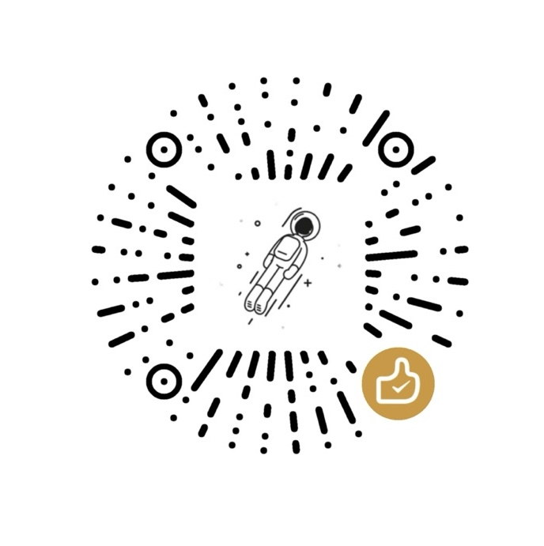

<div align="center">


# DocKit

**Elasticsearch、OpenSearch、DynamoDB、MongoDB 向けのオープンソース GUI クライアント — すべての NoSQL データベースを 1 つのネイティブデスクトップアプリで。**

**プライバシー最優先。データはあなたのもの、キーもあなたのもの。オープンソース。**

[](https://github.com/geek-fun/dockit/releases)
[](https://github.com/geek-fun/dockit/releases)
[](LICENSE)
[](https://github.com/geek-fun/dockit/stargazers)
[](https://github.com/geek-fun/dockit/actions/workflows/node.yml)
[](https://mcptoplist.com/server/io.github.geek-fun%2Fdata-studio)

<p>
  
  
  
  
  
</p>

[ダウンロード](https://www.geekfun.club/download) · [ドキュメント](https://www.geekfun.club/docs/dockit/) · [公式サイト](https://www.geekfun.club/products/dockit/) · [Releases](https://github.com/geek-fun/dockit/releases)

[English](README.md) · [简体中文](README_zh.md) · [Português (BR)](README_pt-BR.md) · 日本語 · [한국어](README_ko.md) · [Español](README_es.md)

</div>

---

DocKit は、Kibana や AWS Console などのブラウザコンソールを 1 つのネイティブデスクトップアプリに置き換えます。必要なことを自然言語で記述すれば実行可能なクエリが得られ、Monaco 搭載のエディタを直接使うこともできます。OpenAI、Anthropic、DeepSeek に対応 — お使いのキーをご利用いただけます。

<p align="center">
  
  
  
  
  
</p>

<p align="center">
  
</p>

## インストール

<a href="https://www.geekfun.club/download">
  <picture>
    <source media="(prefers-color-scheme: dark)" srcset="https://img.shields.io/badge/Download-macOS_|_Windows_|_Linux-orange&logo=download&logoColor=white">
    
  </picture>
</a>
&nbsp;
<a href="https://github.com/geek-fun/dockit/releases">
  
</a>
&nbsp;
<a href="https://www.geekfun.club/products/dockit/">
  
</a>

## Community と Ultimate

DocKit は単一の公式ビルドと、ランタイムで切り替える Community/Ultimate モードを採用しています（ソースコードは Apache-2.0 のままです）。

**Community（永久に無料）：** すべてのデータソース（Elasticsearch / OpenSearch / DynamoDB / MongoDB / EasySearch）、基本の直接認証（ユーザー/パスワード、静的アクセスキー）による無制限の接続、TLS、OS キーチェーンによる資格情報の暗号化、Monaco 搭載のフルエディタとビジュアルクエリビルダー、データ閲覧とインライン編集、結果セットのエクスポート（CSV / JSON / Markdown / コピー）、クエリ履歴と保存済みクエリ、メタデータ閲覧、DynamoDB Local。

**Ultimate（$9.9/月 · $99/年、7 日間の無料トライアル）：**

| 機能 | 含まれる |
|---|---|
| AI — エージェント、NL2SQL、説明、最適化、ワンクリック修復（LLM キーはご自身のものをご利用ください） | ✅ |
| クラスタ管理とモニタリング — ノード、シャード、インデックス、テンプレート、allocation | ✅ |
| 内蔵 MCP Server | ✅ |
| バッチ / ファイル単位のインポート＆エクスポート | ✅ |
| リモート接続の拡張 — SSH トンネル、HTTP/SOCKS プロキシ | ✅ |
| クラウド資格情報 — AWS Profile / SSO / IAM | ✅ |

**バージョンロック：** 有効なサブスクリプション期間中にリリースされたすべてのバージョンは、永久にアンロックされたままです — オフラインでも、サブスクリプション終了後も同様です。7 日間のトライアルでは期間中すべての機能がアンロックされますが、バージョンロックの権利は付与されません。クラウドサービス（同期など）には有効なサブスクリプションが必要です。

詳細は[料金ページ](https://www.geekfun.club/pricing)をご覧ください。

## 主な機能

### Agentic Data Studio

必要なことを自然言語で記述するだけで — エージェントがクエリの作成、スキーマの確認、ドキュメントの更新、レコードの削除、インデックスの作成を行い、結果を返します。

- **クエリ生成** — 自然言語から Elasticsearch DSL、PartiQL、MongoDB クエリへ
- **スキーマ検査** — エージェントがデータベースのスキーマを読み取り、説明します
- **データ操作** — 会話を通じた CRUD、インデックス管理、一括操作
- **安全性** — データソースごとの権限、破壊的な操作に対する確認ゲート、資格情報は LLM に決して渡されません
- **対応プロバイダー** — OpenAI、Anthropic、DeepSeek、Requesty、Opper、Atlas Cloud、[API Route](https://api-route.com)、Cheaper Inference、Runcrate、CloudGPU、cheapaimodel、[Standard Compute](https://standardcompute.com)、[UberLLM](https://uberllm.dev)、Ollama、LM Studio

### DynamoDB

DynamoDB 向けのビジュアルツール — クエリビルダー、PartiQL エディタ、テーブル管理、インポート/エクスポート。

- **クエリビルダー** — プライマリキーによるフィルタリングと 13 以上の演算子で scan/query
- **PartiQL エディタ** — オートコンプリート、シンタックスハイライト、インラインでのアイテム CRUD
- **テーブル管理** — テーブルの作成・変更、インデックス（GSI/LSI）の管理、TTL、ストリーム、PITR、暗号化
- **DynamoDB Local** — AWS 資格情報なしでオフライン開発
- **認証** — AWS プロファイル、SSO、アクセスキー、IAM ロール

### MongoDB

クエリエディタ、ドキュメントブラウザ、インポート/エクスポートを備えたフル機能の MongoDB クライアント。

- **クエリエディタ** — オートコンプリート、結果の整形、バルク書き込み対応
- **ドキュメントブラウザ** — ページネーション、インライン CRUD
- **管理ビュー** — インデックス、ストレージ統計、コレクションメタデータをひと目で確認
- **接続** — 認証、TLS、レプリカセット構成
- **インポート / エクスポート** — JSON、CSV、JSONL

### Elasticsearch & OpenSearch

独立した設定を持つ別々の接続タイプ。完全なシンタックスハイライトとオートコンプリートを備えた Monaco 搭載エディタ。

- **クラスタ管理** — ノードの状態、シャードの状態、インデックスの追跡、エイリアスの制御
- **認証** — ES と OpenSearch の両方にネイティブ API キーで対応
- **エディタ** — Monaco（VS Code エンジン）、JSON5、インラインコメント、ライブマッピングからのフィールド補完
- **文法カタログ** — 120 以上の ES および OpenSearch API エンドポイントのリファレンス
- **バージョン対応** — Elasticsearch 1.x–9.x、OpenSearch 1.x–3.x

### 管理とモニタリング

- **クラスタの状態** — ノードのステータス、シャードの状態、ストレージ指標
- **インデックス管理** — 作成、削除、オープン、クローズ、エイリアスとマッピングの管理
- **テーブル/コレクションのメタデータ** — スキーマ、インデックス、設定の表示と編集

### クエリ履歴

- **自動記録** — すべてのクエリを保存、手動保存は不要
- **接続ごとに 500 件** — ローカル保存、検索可能
- **リプレイ** — コピー、エディタへの再読み込み、過去のクエリの再実行
- **対象** — PartiQL、MongoDB、ビジュアルフォームクエリ

### インポートとエクスポート

- **フォーマット** — JSON、CSV、JSONL
- **スケール** — バッチ操作で数百万件のレコードを処理
- **ユースケース** — クラスタ移行、バックアップ、開発環境の初期データ投入

### プライバシーとセキュリティ

- **テレメトリなし** — DocKit はデータを外部に送信しません
- **ローカル保存** — クエリ、資格情報、分析データはすべて手元のマシンに
- **暗号化** — 接続プロファイルは OS のキーチェーンで保護
- **エアギャップ** — 完全オフライン対応、インターネット不要

### アクセシビリティ

- **キーボード操作** — すべてのインタラクティブ要素を Tab で移動、リストやツリーでは矢印キー、Enter/スペースで実行
- **スクリーンリーダー** — アクションボタンとクエリ結果を完全にサポート
- **フォーカス表示** — すべてのインタラクティブ要素に表示


## 開発
DocKit は [Tauri](https://tauri.app/)（Rust）、Vue 3 + TypeScript、[shadcn-vue](https://www.shadcn-vue.com/)、[UnoCSS](https://unocss.dev/)、[Monaco Editor](https://microsoft.github.io/monaco-editor/)、Pinia で構築されています。

### 前提条件

- Node.js >= 20
- NPM >= 10
- Rust ツールチェーン（Tauri 用）

### セットアップ

```bash
git clone https://github.com/geek-fun/dockit.git --depth=1
cd dockit
npm install
npm run tauri dev
```

### ビルド

```bash
npm run tauri build         # 現在のプラットフォーム
npm run build:macos         # macOS Universal
```


## コントリビューション

Issue や PR を歓迎します。[コントリビューションガイド](CONTRIBUTION.md)をご確認ください。

## コミュニティ

<p align="center">
  
</p>

<p align="center">
  <a href="https://x.com/geekfun_club"></a>
  &nbsp;&nbsp;&nbsp;
  <a href="https://www.youtube.com/@geekfun-club"></a>
  &nbsp;&nbsp;&nbsp;
  <a href="https://github.com/geek-fun"></a>
</p>

## スポンサー

<p align="center">
  
  &nbsp;&nbsp;&nbsp;&nbsp;&nbsp;
  <a href="https://github.com/sponsors/geek-fun"></a>
</p>

## ライセンス

[Apache 2.0](LICENSE) © GEEKFUN
