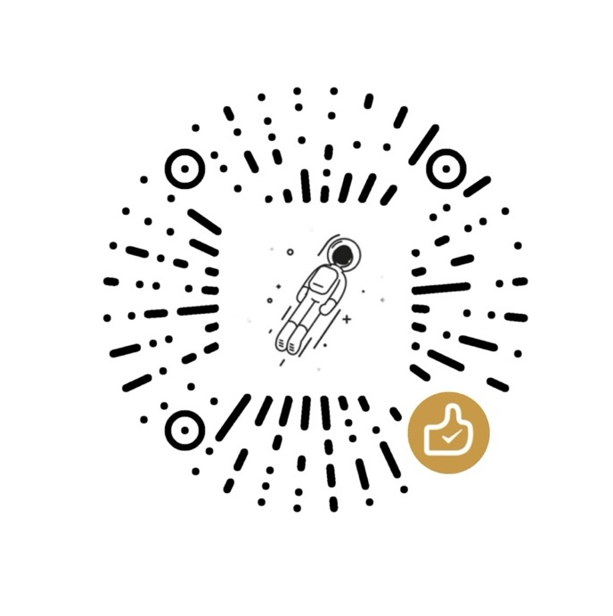

<div align="center">


# DocKit

**Elasticsearch, OpenSearch, DynamoDB, MongoDB용 오픈소스 GUI 클라이언트 — 하나의 네이티브 데스크톱 앱으로 모든 NoSQL 데이터베이스를 관리하세요.**

**프라이버시 최우선. 데이터도, 키도 모두 여러분의 것. 오픈소스.**

[](https://github.com/geek-fun/dockit/releases)
[](https://github.com/geek-fun/dockit/releases)
[](LICENSE)
[](https://github.com/geek-fun/dockit/stargazers)
[](https://github.com/geek-fun/dockit/actions/workflows/node.yml)
[](https://mcptoplist.com/server/io.github.geek-fun%2Fdata-studio)

<p>
  
  
  
  
  
</p>

[다운로드](https://www.geekfun.club/download) · [문서](https://www.geekfun.club/docs/dockit/) · [웹사이트](https://www.geekfun.club/products/dockit/) · [Releases](https://github.com/geek-fun/dockit/releases)

[English](README.md) · [简体中文](README_zh.md) · [Português (BR)](README_pt-BR.md) · [日本語](README_ja.md) · 한국어 · [Español](README_es.md)

</div>

---

DocKit은 Kibana, AWS Console 같은 브라우저 콘솔을 하나의 네이티브 데스크톱 앱으로 대체합니다. 필요한 것을 자연어로 설명하면 실행 가능한 쿼리를 얻을 수 있고, Monaco 기반 에디터를 직접 사용할 수도 있습니다. OpenAI, Anthropic, DeepSeek를 지원합니다 — 자신의 키를 가져와 사용하세요.

<p align="center">
  
  
  
  
  
</p>

<p align="center">
  
</p>

## 설치

**macOS**(Apple Silicon 및 Intel `.dmg`), **Windows**(`.exe` / `.msi`), **Linux**(`.deb`, `.rpm`, `.AppImage`)용 최신 설치 프로그램을 다운로드하세요:

- **[다운로드 페이지 (geekfun.club)](https://www.geekfun.club/ko/download#dockit)** — macOS, Windows, Linux 설치 파일 바로 받기
- **[GitHub Releases](https://github.com/geek-fun/dockit/releases/latest)** — 전체 설치 파일 및 릴리스 노트

> DocKit 창을 닫아도 백그라운드 작업과 MCP 서버는 계속 실행됩니다. 메뉴 막대 또는 시스템 트레이 아이콘에서 **창 표시**로 돌아가거나 **종료**로 앱을 중지할 수 있습니다.

### AI 에이전트 연동 (MCP)

[`@geek-fun/data-studio-mcp`](https://github.com/geek-fun/data-studio-agent)를 통해 Claude Code, OpenAI Codex, Cursor, Windsurf, OpenCode 및 모든 MCP 클라이언트를 DocKit 데이터베이스에 연결할 수 있습니다.

```bash
# Claude Code
claude mcp add --transport stdio data-studio -- npx -y @geek-fun/data-studio-mcp

# OpenAI Codex
codex mcp add data-studio -- npx -y @geek-fun/data-studio-mcp

# 직접 실행
npx -y @geek-fun/data-studio-mcp
```

<details>
<summary><strong>JSON 설정 (Cursor, Windsurf, .mcp.json 또는 사용자 지정 포트)</strong></summary>

`.mcp.json`, `.cursor/mcp.json` 또는 `~/.cursor/mcp.json`에 추가하세요(포트 자동 감지를 사용하려면 `env` 생략 가능, 기본값 `9120`):

```json
{
  "mcpServers": {
    "data-studio": {
      "command": "npx",
      "args": ["-y", "@geek-fun/data-studio-mcp"],
      "env": {
        "DOCKIT_MCP_PORT": "9120"
      }
    }
  }
}
```

</details>

- **로컬 및 프라이빗** — `127.0.0.1` 로컬 HTTP 브리지로 동작하며, 자격 증명은 DocKit 내부에만 보관되고 에이전트에는 불투명한 연결 ID만 노출됩니다
- **세분화된 권한** — **설정 → MCP 브리지 → 기본 AI 권한**(**접근 없음**, **읽기**, **데이터 읽기 및 수정**, **전체 접근**, **사용자 지정**) 및 연결별 개별 설정을 지원합니다
- **NoSQL 도구** — 연결 목록 조회, 인덱스·매핑·컬렉션·DynamoDB 테이블 구조 확인, 쿼리 실행 및 허용된 작업을 수행합니다

> **참고:** **설정 → MCP 브리지**의 **자동 시작**(기본값 켜짐)을 켠 상태로 DocKit을 실행해 두세요(창을 닫아도 메뉴 막대 또는 시스템 트레이에서 계속 실행됩니다). [SqlKit](https://github.com/geek-fun/sqlkit)과 함께 실행하면 동일한 MCP 서버로 NoSQL과 SQL 데이터베이스를 모두 사용할 수 있습니다.
>
> **문서:** [MCP 브리지 가이드](https://www.geekfun.club/docs/dockit/mcp-bridge) · [빠른 시작](https://www.geekfun.club/docs/data-studio-agent/quick-start) · [MCP 서버 README](https://github.com/geek-fun/data-studio-agent/blob/master/packages/data-studio-mcp/README.md)

## 주요 기능

### Agentic Data Studio

자연어로 필요한 것을 설명하면 — 에이전트가 쿼리를 작성하고, 스키마를 검사하고, 문서를 업데이트하고, 레코드를 삭제하고, 인덱스를 생성한 뒤 결과를 반환합니다.

- **쿼리 생성** — 자연어를 Elasticsearch DSL, PartiQL, MongoDB 쿼리로 변환
- **스키마 검사** — 에이전트가 데이터베이스 스키마를 읽고 설명합니다
- **데이터 작업** — 대화를 통한 CRUD, 인덱스 관리, 일괄 작업
- **안전성** — 소스별 권한, 파괴적 작업에 대한 확인 게이트, 자격 증명은 LLM에 노출되지 않음
- **지원 프로바이더** — OpenAI, Anthropic, DeepSeek, Requesty, Opper, Atlas Cloud, [API Route](https://api-route.com), Cheaper Inference, Runcrate, CloudGPU, cheapaimodel, [Standard Compute](https://standardcompute.com), [MartLLM](https://martllm.com), Ollama, LM Studio

### DynamoDB

DynamoDB용 비주얼 도구 — 쿼리 빌더, PartiQL 에디터, 테이블 관리, 가져오기/내보내기.

- **쿼리 빌더** — 기본 키 필터링과 13개 이상의 연산자로 scan/query
- **PartiQL 에디터** — 자동 완성, 구문 강조, 인라인 항목 CRUD
- **테이블 관리** — 테이블 생성·수정, 인덱스(GSI/LSI) 관리, TTL, 스트림, PITR, 암호화
- **DynamoDB Local** — AWS 자격 증명 없이 오프라인 개발
- **인증** — AWS 프로파일, SSO, 액세스 키, IAM 역할

### MongoDB

쿼리 에디터, 문서 브라우저, 가져오기/내보내기를 갖춘 풀 기능 MongoDB 클라이언트입니다.

- **쿼리 에디터** — 자동 완성, 결과 포매팅, 벌크 쓰기 지원
- **문서 브라우저** — 페이지네이션, 인라인 CRUD
- **관리 뷰** — 인덱스, 스토리지 통계, 컬렉션 메타데이터를 한눈에 확인
- **연결** — 인증, TLS, 레플리카 셋 구성
- **가져오기 / 내보내기** — JSON, CSV, JSONL

### Elasticsearch & OpenSearch

독립적인 설정을 가진 별도의 연결 유형. 완전한 구문 강조와 자동 완성을 갖춘 Monaco 기반 에디터.

- **클러스터 관리** — 노드 상태, 샤드 상태, 인덱스 추적, 별칭 제어
- **인증** — ES와 OpenSearch 모두 네이티브 API 키 지원
- **에디터** — Monaco(VS Code 엔진), JSON5, 인라인 주석, 실시간 매핑 기반 필드 자동 완성
- **문법 카탈로그** — 120개 이상의 ES 및 OpenSearch API 엔드포인트 참조
- **버전 지원** — Elasticsearch 1.x–9.x, OpenSearch 1.x–3.x

### 관리 및 모니터링

- **클러스터 상태** — 노드 상태, 샤드 상태, 스토리지 지표
- **인덱스 관리** — 생성, 삭제, 열기, 닫기, 별칭 및 매핑 관리
- **테이블/컬렉션 메타데이터** — 스키마, 인덱스, 설정 조회 및 편집

### 쿼리 히스토리

- **자동 기록** — 모든 쿼리 저장, 수동 저장 불필요
- **연결당 500개 항목** — 로컬 저장, 검색 가능
- **재실행** — 복사, 에디터로 다시 불러오기, 과거 쿼리 재실행
- **범위** — PartiQL, MongoDB, 비주얼 폼 쿼리

### 가져오기 및 내보내기

- **형식** — JSON, CSV, JSONL
- **규모** — 배치 작업으로 수백만 건의 레코드 처리
- **활용 사례** — 클러스터 마이그레이션, 백업, 개발 환경 초기 데이터 구성

### 프라이버시 및 보안

- **텔레메트리 없음** — DocKit은 데이터를 외부로 전송하지 않습니다
- **로컬 저장** — 쿼리, 자격 증명, 분석 데이터는 모두 사용자 머신에
- **암호화** — 연결 프로파일은 OS 키체인으로 보호
- **에어갭** — 완전한 오프라인 동작, 인터넷 불필요

### 접근성

- **키보드 탐색** — Tab으로 모든 인터랙티브 요소 이동, 목록과 트리에서 방향키, Enter/스페이스로 활성화
- **스크린 리더** — 액션 버튼과 쿼리 결과 완전 접근 가능
- **포커스 표시** — 모든 인터랙티브 요소에 표시


## 개발
DocKit은 [Tauri](https://tauri.app/)(Rust), Vue 3 + TypeScript, [shadcn-vue](https://www.shadcn-vue.com/), [UnoCSS](https://unocss.dev/), [Monaco Editor](https://microsoft.github.io/monaco-editor/), Pinia로 빌드되었습니다.

### 사전 요구 사항

- Node.js >= 20
- NPM >= 10
- Rust 툴체인(Tauri용)

### 설정

```bash
git clone https://github.com/geek-fun/dockit.git --depth=1
cd dockit
npm install
npm run tauri dev
```

### 빌드

```bash
npm run tauri build         # 현재 플랫폼
npm run build:macos         # macOS Universal
```


## 기여

이슈와 PR을 환영합니다. [기여 가이드](CONTRIBUTION.md)를 확인해 주세요.

## 커뮤니티

<p align="center">
  
</p>

<p align="center">
  <a href="https://x.com/geekfun_club"></a>
  &nbsp;&nbsp;&nbsp;
  <a href="https://www.youtube.com/@geekfun-club"></a>
  &nbsp;&nbsp;&nbsp;
  <a href="https://github.com/geek-fun"></a>
</p>

## 스폰서

<p align="center">
  
  &nbsp;&nbsp;&nbsp;&nbsp;&nbsp;
  <a href="https://github.com/sponsors/geek-fun"></a>
</p>

## 라이선스

[Apache 2.0](LICENSE) © GEEKFUN
